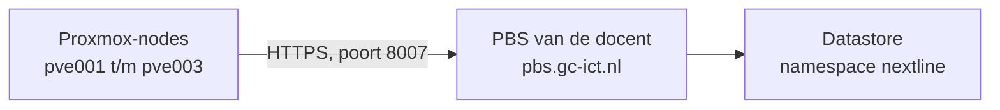

# Back-up: Proxmox Backup Server

[← Terug naar README](../../README.md) · [Cluster1 – overzicht](overzicht.md)

## Overzicht

| Onderdeel | Waarde |
| --- | --- |
| Back-upserver | `pbs.gc-ict.nl` (server van de docent, buiten het cluster) |
| Webinterface | `https://pbs.gc-ict.nl:8007` |
| Gebruiker | `nextline@pbs` (het wachtwoord staat **niet** in deze repo) |
| Datastore | `Datastore` |
| Namespace | `nextline` |
| Storage-ID in Proxmox | `pbs-nextline` |
| Wat wordt geback-upt | Alle containers en VM's van pve001 t/m pve003 |
| Mode | `Snapshot` (containers blijven draaien) |
| Schema | `<lesdagen en tijd invullen>`, met **Repeat missed** aan |
| Bewaren | 7 dagelijkse en 4 wekelijkse back-ups |
| Encryptie | Uit |

## Hoe het werkt



Proxmox maakt een back-up van alle containers en VM's en stuurt die naar de Proxmox Backup Server (PBS) van de docent. Die server staat buiten ons cluster. Valt het hele cluster uit, dan blijven de back-ups bewaard. Na de eerste volledige back-up gaan alleen de wijzigingen over de lijn.

Het cluster gaat na de les uit. Daarom draait de back-up tijdens de les. Staat het cluster uit op het geplande moment, dan haalt Proxmox de back-up in bij het opstarten (**Repeat missed**). Voor het afsluiten maken we ook nog handmatig een back-up.

### Koppeling met FO en TO

| FO/TO | Hoe dit eraan voldoet |
| --- | --- |
| FR14 – back-up en herstel | Back-ups van alle containers en VM's op een externe server, herstel via Proxmox |
| NFR4 – automatisch en periodiek | Back-upjob op lesdagen, gemiste back-ups worden ingehaald |
| US21 / US26 – back-ups van infrastructuur en challenge-definities | Alle containers in de back-up, challenge-definities staan ook in GitHub |
| T-04 – back-up / restore | Zie [Hersteltest](#hersteltest-t-04) |

---

## Installatie (zo is het gedaan)

### Stap 1: Verbinding testen

Waar: **pve001, pve002 en pve003 > Shell**

```
curl -sk -o /dev/null -w "%{http_code}\n" https://pbs.gc-ict.nl:8007
```

De uitkomst moet `200` zijn.

### Stap 2: PBS toevoegen als opslag

Waar: **Datacenter > Storage > Add > Proxmox Backup Server**

1. Vul op het tabblad **General** dit in:

| Veld | Waarde |
| --- | --- |
| ID | `pbs-nextline` |
| Server | `pbs.gc-ict.nl` |
| Username | `nextline@pbs` |
| Password | uit het document van de docent |
| Fingerprint | uit het document van de docent |
| Datastore | `Datastore` |
| Namespace | `nextline` |
| Nodes | `All (No restrictions)` |
| Enable | aangevinkt |

2. Laat het tabblad **Backup Retention** op **Keep all backups** staan.
3. Laat het tabblad **Encryption** op **Do not encrypt backups** staan.
4. Klik op **Add**.

### Stap 3: Back-upjob maken

Waar: **Datacenter > Backup > Add**

1. Vul op het tabblad **General** dit in:

| Veld | Waarde |
| --- | --- |
| Node | `-- All --` |
| Storage | `pbs-nextline` |
| Schedule | lesdagen en tijd, bijvoorbeeld `tue,thu 10:00` |
| Selection mode | `All` |
| Mode | `Snapshot` |
| Enable | aangevinkt |

2. Vul op het tabblad **Retention** dit in:

| Veld | Waarde |
| --- | --- |
| Keep all backups | uitgevinkt |
| Keep Daily | `7` |
| Keep Weekly | `4` |

3. Vink op het tabblad **Advanced** de optie **Repeat missed** aan.
4. Klik op **Create**.

### Stap 4: Eerste back-up maken

Waar: **Datacenter > Backup**

1. Selecteer de back-upjob en klik op **Run now**.
2. Controleer bij **Tasks** dat de back-up op elke node op **OK** eindigt.

---

## Controleren

Waar: **pve001 > Shell**

```
pvesm status | grep pbs-nextline
```

Achter `pbs-nextline` moet `active` staan.

Alle back-ups bekijken:

```
pvesm list pbs-nextline
```

Waar: **browser**

1. Open `https://pbs.gc-ict.nl:8007`.
2. Log in met username `nextline` en realm **Proxmox Backup authentication server**.
3. Ga naar **Datastore > Datastore > Content** en kies namespace `nextline`.
4. Selecteer de nieuwste back-up en klik op **Verify**.

## Hersteltest (T-04)

Waar: **Proxmox-webinterface**

1. Maak een testcontainer met ID `900` en naam `test-backup`, met de schijf op `ceph-vm`.
2. Selecteer de container en ga naar **Backup > Backup now**. Kies Storage `pbs-nextline`, Mode `Snapshot` en klik op **Backup**.
3. Stop de container. Ga naar **More > Remove**, vink **Destroy unreferenced disks** aan, typ `900` en klik op **Remove**.
4. Ga naar **pve001 > pbs-nextline > Backups**, selecteer de back-up van `900` en klik op **Restore**.
5. Kies Storage `ceph-vm` en klik op **Restore**.
6. Start de container en controleer of hij werkt.
7. Maak screenshots van het verwijderen, de restore-taak en de draaiende container als bewijs.

## Beheer

| Wanneer | Wat |
| --- | --- |
| Elke les, na het opstarten | Controleer bij **Tasks** of de back-up op **OK** staat. Zo niet: **Run now** |
| Einde van de les | **Datacenter > Backup**, job selecteren, **Run now**, wachten tot alles op **OK** staat, dan pas de nodes uitzetten |
| Wekelijks | Nieuwste back-ups controleren met **Verify** in de PBS-webinterface |
| Per kwartaal | Hersteltest uitvoeren |

## Problemen oplossen

| Probleem | Oplossing |
| --- | --- |
| `curl` geeft `000` | De node kan de PBS niet bereiken. Controleer DNS en de internetverbinding van de node. |
| `pbs-nextline` staat niet op `active` | Controleer gebruikersnaam, wachtwoord en fingerprint bij **Datacenter > Storage > pbs-nextline > Edit**. |
| Back-up mislukt direct na het opstarten | Ceph was nog niet klaar. Klik op **Run now**. |
| Foutmelding over rechten bij het opruimen (prune) | Ons account mag geen oude back-ups verwijderen. Vraag de docent om prune-rechten op namespace `nextline`. |
| Back-up is afgebroken | De node is uitgezet tijdens de back-up. Klik op **Run now**. |

## Let op

- **Zet het wachtwoord van `nextline@pbs` nooit in deze repo.**
- Zet de nodes nooit uit terwijl er een back-up loopt.
- Herstel een bestaande container niet naast het origineel. De kopie krijgt hetzelfde IP-adres en dat geeft een conflict. Gebruik een testcontainer.
- Gaat encryptie ooit aan, bewaar de sleutel dan ook buiten het cluster. Zonder die sleutel zijn de back-ups onbruikbaar als het cluster weg is.
