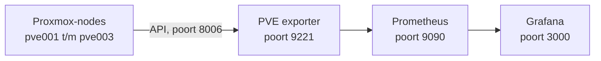

# Monitoring: Prometheus + Grafana

[← Terug naar README](../../README.md) · [Cluster1 – overzicht](overzicht.md)

## Overzicht

| Onderdeel | Waarde |
| --- | --- |
| Container | `Ubuntu-server` op pve001 |
| IP-adres container | `<IP-Ubuntu-server>` ← invullen |
| Grafana | `http://<IP-Ubuntu-server>:3000` |
| Prometheus | `http://<IP-Ubuntu-server>:9090` |
| PVE exporter | `127.0.0.1:9221` (alleen bereikbaar binnen de container) |
| Proxmox-gebruiker | `prometheus@pve`, rol `PVEAuditor` (alleen lezen) |
| API-token | `prometheus@pve!monitoring` (de geheime waarde staat **niet** in deze repo) |
| Grafana-dashboard | 10347 – *Proxmox via Prometheus* |
| Ophaalinterval | 15 seconden |

## Hoe het werkt



| Onderdeel | Taak |
| --- | --- |
| PVE exporter | Haalt via de Proxmox-API gegevens op van alle nodes en containers. |
| Prometheus | Haalt die gegevens elke 15 seconden op en bewaart ze. |
| Grafana | Toont de gegevens in dashboards. |

Per node en per container zie je: status, CPU, geheugen, schijf, netwerk en uptime. Ook de HA-status en de storage (waaronder `ceph-vm`) zijn zichtbaar.

## Bestanden in de container

| Bestand in de container | Doel | Kopie in deze repo |
| --- | --- | --- |
| `/etc/prometheus/prometheus.yml` | Configuratie van Prometheus | [configs/prometheus/prometheus.yml](../../configs/prometheus/prometheus.yml) |
| `/etc/prometheus/pve.yml` | Login van de exporter (**bevat het token**) | [configs/prometheus/pve.yml.example](../../configs/prometheus/pve.yml.example) |
| `/etc/systemd/system/pve-exporter.service` | Service van de exporter | [configs/systemd/pve-exporter.service](../../configs/systemd/pve-exporter.service) |
| `/opt/pve-exporter/` | Programma van de exporter | – |

---

## Installatie (zo is het gedaan)

### Stap 1: leesgebruiker aanmaken

Waar: **pve001 > Shell**

1. Voer uit:

```
pveum user add prometheus@pve --comment "Monitoring"
pveum acl modify / --users prometheus@pve --roles PVEAuditor
pveum user token add prometheus@pve monitoring --privsep 0
```

2. Kopieer de waarde achter **value**. Dit is het token.

### Stap 2: Prometheus installeren

Waar: **Ubuntu-server > Console**

```
apt update
apt install -y prometheus python3-venv curl wget gnupg
```

### Stap 3: Grafana installeren

Waar: **Ubuntu-server > Console**

```
mkdir -p /etc/apt/keyrings
wget -O /etc/apt/keyrings/grafana.asc https://apt.grafana.com/gpg-full.key
chmod 644 /etc/apt/keyrings/grafana.asc
echo "deb [signed-by=/etc/apt/keyrings/grafana.asc] https://apt.grafana.com stable main" > /etc/apt/sources.list.d/grafana.list
apt update
apt install -y grafana
systemctl enable --now grafana-server
```

### Stap 4: PVE exporter installeren

Waar: **Ubuntu-server > Console**

1. Installeer de exporter:

```
python3 -m venv /opt/pve-exporter
/opt/pve-exporter/bin/pip install prometheus-pve-exporter
```

2. Maak `/etc/prometheus/pve.yml` aan met de inhoud van [pve.yml.example](../../configs/prometheus/pve.yml.example). Vul het echte token in.

```
nano /etc/prometheus/pve.yml
```

3. Stel de rechten in:

```
chown root:prometheus /etc/prometheus/pve.yml
chmod 640 /etc/prometheus/pve.yml
```

4. Zet [pve-exporter.service](../../configs/systemd/pve-exporter.service) in `/etc/systemd/system/` en start de service:

```
systemctl daemon-reload
systemctl enable --now pve-exporter
```

5. Test de exporter. Je hoort regels met `pve_up` te zien:

```
curl -s "http://127.0.0.1:9221/pve?target=192.168.10.11&cluster=1&node=1" | grep pve_up
```

### Stap 5: Prometheus configureren

Waar: **Ubuntu-server > Console**

1. Zet de inhoud van [prometheus.yml](../../configs/prometheus/prometheus.yml) in `/etc/prometheus/prometheus.yml`.
2. Controleer de configuratie. Er hoort **SUCCESS** te staan:

```
promtool check config /etc/prometheus/prometheus.yml
```

3. Herstart Prometheus:

```
systemctl restart prometheus
```

4. Open `http://<IP-Ubuntu-server>:9090/targets`. Bij **pve** horen 3 targets op **UP** te staan.

### Stap 6: Grafana instellen

Waar: **browser**

1. Open `http://<IP-Ubuntu-server>:3000` en log in. De eerste keer is dat **admin** / **admin**; daarna kies je een nieuw wachtwoord.
2. Ga naar **Connections > Data sources > Add data source > Prometheus**.
3. Prometheus server URL: `http://localhost:9090`
4. Klik op **Save & test**.
5. Ga naar **Dashboards > New > Import**, vul `10347` in en klik op **Load**.
6. Kies de Prometheus-databron en klik op **Import**.

---

## Beheer

Waar: **Ubuntu-server > Console**

Status van de diensten:

```
systemctl status prometheus grafana-server pve-exporter
```

Logboek van de exporter:

```
journalctl -u pve-exporter -n 50
```

Alles bijwerken:

```
apt update && apt upgrade -y
/opt/pve-exporter/bin/pip install --upgrade prometheus-pve-exporter
systemctl restart pve-exporter
```

Nieuw token maken (waar: **pve001 > Shell**):

```
pveum user token remove prometheus@pve monitoring
pveum user token add prometheus@pve monitoring --privsep 0
```

Zet daarna het nieuwe token in `/etc/prometheus/pve.yml` en voer `systemctl restart pve-exporter` uit.

## Problemen oplossen

| Probleem | Oplossing |
| --- | --- |
| Targets bij **pve** staan op DOWN | Controleer `systemctl status pve-exporter`. |
| Fout over authenticatie in het logboek van de exporter | Het token in `pve.yml` klopt niet. Maak een nieuw token. |
| `promtool` geeft een fout | Controleer de inspringing (spaties) in `prometheus.yml`. |
| Grafana toont **No data** | Controleer bij de data source de URL `http://localhost:9090` en klik op **Save & test**. |

## Later uitbreiden (optioneel)

- Meer detail per container (processen, diensten): installeer `prometheus-node-exporter` in die container en voeg het IP-adres met poort `9100` toe als extra target in `prometheus.yml`.
- Ceph apart monitoren: voer op pve001 `ceph mgr module enable prometheus` uit en voeg de nodes met poort `9283` toe als target.

## Let op

- **Zet het echte token nooit in GitHub.** Alleen `pve.yml.example` hoort in deze repo.
- Maak Grafana en Prometheus nooit bereikbaar vanaf internet.
- Zet de schijf van `Ubuntu-server` op `ceph-vm` en voeg de container toe aan HA. Anders valt de monitoring weg als pve001 uitvalt.
