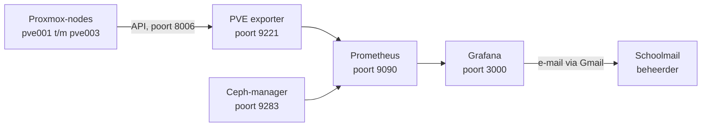

# Monitoring: Prometheus + Grafana

[← Terug naar README](../../README.md) · [Cluster1 – overzicht](overzicht.md)

## Overzicht

| Onderdeel | Waarde |
| --- | --- |
| Container | `Ubuntu-server` op pve001 |
| IP-adres container | `192.168.10.20` |
| Grafana | `http://192.168.10.20:3000` |
| Prometheus | `http://192.168.10.20:9090` |
| PVE exporter | `127.0.0.1:9221` (alleen bereikbaar binnen de container) |
| Proxmox-gebruiker | `prometheus@pve`, rol `PVEAuditor` (alleen lezen) |
| API-token | `prometheus@pve!monitoring` (de geheime waarde staat **niet** in deze repo) |
| Grafana-dashboards | *Cluster1 – Overzicht* (eigen dashboard) en 10347 – *Proxmox via Prometheus* |
| Ceph-metingen | Prometheus-module van de Ceph-manager, poort `9283` op pve001 t/m pve003 |
| Meldingen | Grafana Alerting, per e-mail naar `youri.bochoven@student.graafschapcollege.nl` |
| Afzender meldingen | `nextline.monitoring@gmail.com` (het app-wachtwoord staat **niet** in deze repo) |
| Ophaalinterval | 15 seconden |

## Hoe het werkt



| Onderdeel | Taak |
| --- | --- |
| PVE exporter | Haalt via de Proxmox-API gegevens op van alle nodes en containers. |
| Prometheus | Haalt die gegevens elke 15 seconden op en bewaart ze. |
| Grafana | Toont de gegevens in dashboards. |
| Ceph-manager | Geeft de status van Ceph door: HEALTH_OK, HEALTH_WARN of HEALTH_ERR. |
| Grafana Alerting | Controleert elke minuut de alert-regels en stuurt een e-mail bij een probleem. |

Per node en per container zie je: status, CPU, geheugen, schijf, netwerk en uptime. Ook de HA-status en de storage (waaronder `ceph-vm`) zijn zichtbaar.

## Bestanden in de container

| Bestand in de container | Doel | Kopie in deze repo |
| --- | --- | --- |
| `/etc/prometheus/prometheus.yml` | Configuratie van Prometheus | [configs/prometheus/prometheus.yml](../../configs/prometheus/prometheus.yml) |
| `/etc/prometheus/pve.yml` | Login van de exporter (**bevat het token**) | [configs/prometheus/pve.yml.example](../../configs/prometheus/pve.yml.example) |
| `/etc/systemd/system/pve-exporter.service` | Service van de exporter | [configs/systemd/pve-exporter.service](../../configs/systemd/pve-exporter.service) |
| `/opt/pve-exporter/` | Programma van de exporter | – |
| `/etc/default/grafana-server` | Mailinstellingen van Grafana (**bevat het app-wachtwoord**) | – (zie stap 8) |

---

## Installatie (zo is het gedaan)

### Stap 1: leesgebruiker aanmaken

Waar: **pve001 > Shell**

1. Voer uit:

```
pveum user add prometheus@pve --comment "Monitoring"
pveum acl modify / --users prometheus@pve --roles PVEAuditor
pveum user token add prometheus@pve monitoring --privsep 0
```

2. Kopieer de waarde achter **value**. Dit is het token.

### Stap 2: Prometheus installeren

Waar: **Ubuntu-server > Console**

```
apt update
apt install -y prometheus python3-venv curl wget gnupg
```

### Stap 3: Grafana installeren

Waar: **Ubuntu-server > Console**

```
mkdir -p /etc/apt/keyrings
wget -O /etc/apt/keyrings/grafana.asc https://apt.grafana.com/gpg-full.key
chmod 644 /etc/apt/keyrings/grafana.asc
echo "deb [signed-by=/etc/apt/keyrings/grafana.asc] https://apt.grafana.com stable main" > /etc/apt/sources.list.d/grafana.list
apt update
apt install -y grafana
systemctl enable --now grafana-server
```

### Stap 4: PVE exporter installeren

Waar: **Ubuntu-server > Console**

1. Installeer de exporter:

```
python3 -m venv /opt/pve-exporter
/opt/pve-exporter/bin/pip install prometheus-pve-exporter
```

2. Maak `/etc/prometheus/pve.yml` aan met de inhoud van [pve.yml.example](../../configs/prometheus/pve.yml.example). Vul het echte token in.

```
nano /etc/prometheus/pve.yml
```

3. Stel de rechten in:

```
chown root:prometheus /etc/prometheus/pve.yml
chmod 640 /etc/prometheus/pve.yml
```

4. Zet [pve-exporter.service](../../configs/systemd/pve-exporter.service) in `/etc/systemd/system/` en start de service:

```
systemctl daemon-reload
systemctl enable --now pve-exporter
```

5. Test de exporter. Je hoort regels met `pve_up` te zien:

```
curl -s "http://127.0.0.1:9221/pve?target=192.168.10.11&cluster=1&node=1" | grep pve_up
```

### Stap 5: Prometheus configureren

Waar: **Ubuntu-server > Console**

1. Zet de inhoud van [prometheus.yml](../../configs/prometheus/prometheus.yml) in `/etc/prometheus/prometheus.yml`.
2. Controleer de configuratie. Er hoort **SUCCESS** te staan:

```
promtool check config /etc/prometheus/prometheus.yml
```

3. Herstart Prometheus:

```
systemctl restart prometheus
```

4. Open `http://192.168.10.20:9090` en klik op **Use classic web UI**. Ga naar **Status > Targets**. Bij **pve** horen 3 targets op **UP** te staan.

### Stap 6: Grafana instellen

Waar: **browser**

1. Open `http://192.168.10.20:3000` en log in. De eerste keer is dat **admin** / **admin**; daarna kies je een nieuw wachtwoord.
2. Ga naar **Connections > Data sources > Add data source > Prometheus**.
3. Prometheus server URL: `http://localhost:9090`
4. Klik op **Save & test**.
5. Ga naar **Dashboards > New > Import**, vul `10347` in en klik op **Load**.
6. Kies de Prometheus-databron en klik op **Import**.

### Stap 7: Ceph-metingen toevoegen

Waar: **pve001 > Shell**

1. Zet de Prometheus-module van Ceph aan en controleer of er een regel met **prometheus** verschijnt:

```
ceph mgr module enable prometheus
ceph mgr services
```

Waar: **Ubuntu-server > Console**

2. Open `/etc/prometheus/prometheus.yml` en zet dit blok onderaan, met dezelfde inspringing als `- job_name: 'pve'`:

```
  - job_name: 'ceph'
    static_configs:
      - targets:
          - '192.168.10.11:9283'
          - '192.168.10.12:9283'
          - '192.168.10.13:9283'
```

3. Controleer de configuratie en herstart Prometheus:

```
promtool check config /etc/prometheus/prometheus.yml
systemctl restart prometheus
```

4. Ga in Grafana naar **Explore**, klik op **Code** en voer de query `up{job="ceph"}` uit. Er horen 3 regels met de waarde **1** te staan.

### Stap 8: e-mail instellen

Waar: **browser**, ingelogd op `nextline.monitoring@gmail.com`

1. Ga naar **Beveiliging en inloggen** en voeg een telefoonnummer toe via **Telefoonnummer voor tweestapsverificatie**.
2. Klik op **Tweestapsverificatie** en zet het aan.
3. Maak via `https://myaccount.google.com/apppasswords` een app-wachtwoord met de naam `Grafana`.

Waar: **Ubuntu-server > Console**

4. Open het bestand:

```
nano /etc/default/grafana-server
```

5. Zet deze regels onderaan. Vul het app-wachtwoord in zonder spaties en zonder `< >`.

```
GF_SMTP_ENABLED=true
GF_SMTP_HOST=smtp.gmail.com:587
GF_SMTP_USER=nextline.monitoring@gmail.com
GF_SMTP_PASSWORD=<app-wachtwoord>
GF_SMTP_FROM_ADDRESS=nextline.monitoring@gmail.com
GF_SMTP_FROM_NAME="Grafana Cluster1"
GF_SMTP_STARTTLS_POLICY=MandatoryStartTLS
GF_SERVER_ROOT_URL=http://192.168.10.20:3000/
```

6. Herstart Grafana:

```
systemctl restart grafana-server
```

### Stap 9: contactpunt maken

Waar: **Grafana**

1. Ga naar **Alerting > Contact points** en klik op **+ Add contact point**.
2. Vul in: Name `E-mail beheer`, Integration **Email**, Addresses `youri.bochoven@student.graafschapcollege.nl`.
3. Klik op **Test** en controleer of de testmail binnenkomt.
4. Klik op **Save contact point**.

### Stap 10: alert-regels maken

Waar: **Grafana**. Doe dit voor elke regel in de tabel hieronder.

1. Ga naar **Alerting > Alert rules** en klik op **+ New alert rule**.
2. Vul de naam in, kies de Prometheus-databron, klik op **Code** en plak de query.
3. Stel bij **Alert condition** de voorwaarde in.
4. Kies map `Cluster1` en evaluation group `cluster1` (interval `1m`).
5. Vul de wachttijd in bij **Pending period**.
6. Zet bij **Configure no data and error handling** de optie **Alert state if no data** op **Normal**. Alleen bij *KRITIEK – Node offline* staat deze op **Alerting**.
7. Kies bij **Contact point** de optie **E-mail beheer**, vul de **Summary** in en klik op **Save rule and exit**.

*Query Node-status*

```
label_replace(max by (id) (pve_up{id=~"node/.*"}), "node", "$1", "id", "node/(.*)")
```

*Query CPU node*

```
label_replace(max by (id) (pve_cpu_usage_ratio{id=~"node/.*"}), "node", "$1", "id", "node/(.*)")
```

*Query Geheugen node*

```
label_replace(max by (id) (pve_memory_usage_bytes{id=~"node/.*"}) / max by (id) (pve_memory_size_bytes{id=~"node/.*"}), "node", "$1", "id", "node/(.*)")
```

*Query Ceph-vulling*

```
max(max by (id) (pve_disk_usage_bytes{id=~"storage/.*/ceph-vm"}) / max by (id) (pve_disk_size_bytes{id=~"storage/.*/ceph-vm"}))
```

*Query Ceph-health*

```
max(ceph_health_status)
```

| Regel | Query | Voorwaarde | Wachttijd | Summary |
| --- | --- | --- | --- | --- |
| KRITIEK – Node offline | Node-status | IS BELOW `1` | `1m` | `Node {{ $labels.node }} is offline` |
| Waarschuwing – CPU node | CPU node | IS ABOVE `0.8` | `10m` | `CPU van {{ $labels.node }} is hoger dan 80%` |
| KRITIEK – CPU node | CPU node | IS ABOVE `0.9` | `2m` | `CPU van {{ $labels.node }} is hoger dan 90%` |
| Waarschuwing – Geheugen node | Geheugen node | IS ABOVE `0.8` | `10m` | `Geheugen van {{ $labels.node }} is hoger dan 80%` |
| KRITIEK – Geheugen node | Geheugen node | IS ABOVE `0.9` | `2m` | `Geheugen van {{ $labels.node }} is hoger dan 90%` |
| Waarschuwing – Ceph-opslag | Ceph-vulling | IS ABOVE `0.7` | `5m` | `Ceph-opslag ceph-vm is meer dan 70% vol` |
| KRITIEK – Ceph-opslag | Ceph-vulling | IS ABOVE `0.8` | `2m` | `Ceph-opslag ceph-vm is meer dan 80% vol` |
| Waarschuwing – Ceph-health | Ceph-health | IS ABOVE `0` | `10m` | `Ceph-status is HEALTH_WARN` |
| KRITIEK – Ceph-health | Ceph-health | IS ABOVE `1` | `2m` | `Ceph-status is HEALTH_ERR` |

De drempels komen uit het TO (tabel 5 en 16). Door de korte wachttijd komen kritieke meldingen binnen 5 minuten binnen (NFR5). Het dashboard *Cluster1 – Overzicht* gebruikt dezelfde drempels: CPU en geheugen oranje vanaf 80% en rood vanaf 90%, Ceph oranje vanaf 70% en rood vanaf 80%.

---

## Beheer

Waar: **Ubuntu-server > Console**

Status van de diensten:

```
systemctl status prometheus grafana-server pve-exporter
```

Logboek van de exporter:

```
journalctl -u pve-exporter -n 50
```

Alles bijwerken:

```
apt update && apt upgrade -y
/opt/pve-exporter/bin/pip install --upgrade prometheus-pve-exporter
systemctl restart pve-exporter
```

Nieuw token maken (waar: **pve001 > Shell**):

```
pveum user token remove prometheus@pve monitoring
pveum user token add prometheus@pve monitoring --privsep 0
```

Zet daarna het nieuwe token in `/etc/prometheus/pve.yml` en voer `systemctl restart pve-exporter` uit.

### Meldingen

Meldingen tijdelijk uitzetten, bijvoorbeeld voordat het cluster na de les uitgaat (waar: **Grafana**): ga naar **Alerting > Silences > + New silence**, kies duur `2h` en label `grafana_folder` = `Cluster1`.

Logboek van Grafana, bijvoorbeeld als er geen mail komt:

```
journalctl -u grafana-server -n 30
```

Meldingen testen (T-06):

1. Noteer de tijd en voer `systemctl stop pve-exporter` uit. Binnen 5 minuten komt de mail **KRITIEK – Node offline**.
2. Voer `systemctl start pve-exporter` uit. Er komt een mail met **Resolved**.
3. Zet in Grafana bij **KRITIEK – CPU node** de drempel tijdelijk op `0.01`. Binnen 5 minuten komt een mail. Zet de drempel daarna terug op `0.9`.
4. Bewaar als bewijs het tijdstip en een screenshot van de mail.

## Problemen oplossen

| Probleem | Oplossing |
| --- | --- |
| Targets bij **pve** staan op DOWN | Controleer `systemctl status pve-exporter`. |
| Fout over authenticatie in het logboek van de exporter | Het token in `pve.yml` klopt niet. Maak een nieuw token. |
| `promtool` geeft een fout | Controleer de inspringing (spaties) in `prometheus.yml`. |
| Grafana toont **No data** | Controleer bij de data source de URL `http://localhost:9090` en klik op **Save & test**. |
| Testmail komt niet aan | Kijk in **Ongewenste e-mail** van de schoolmail. Bekijk anders `journalctl -u grafana-server -n 30`. |
| Targets bij **ceph** staan op DOWN | Controleer op pve001 met `ceph mgr services` of de prometheus-module aanstaat. |
| `/targets` toont een pagina over het Debian-pakket | Klik op **Use classic web UI** en ga naar **Status > Targets**. |
| *Waarschuwing – Ceph-health* blijft terugkomen | Bekijk op pve001 met `ceph health detail` wat de oorzaak is. |

## Later uitbreiden (optioneel)

- Meer detail per container (processen, diensten): installeer `prometheus-node-exporter` in die container en voeg het IP-adres met poort `9100` toe als extra target in `prometheus.yml`.

## Let op

- **Zet het echte token nooit in GitHub.** Alleen `pve.yml.example` hoort in deze repo.
- Maak Grafana en Prometheus nooit bereikbaar vanaf internet.
- Zet de schijf van `Ubuntu-server` op `ceph-vm` en voeg de container toe aan HA. Anders valt de monitoring weg als pve001 uitvalt.
- **Zet het app-wachtwoord van Gmail nooit in GitHub.** Het staat alleen in `/etc/default/grafana-server` in de container.
- Na het opstarten van het cluster staat Ceph een paar minuten op HEALTH_WARN. Daarom wacht de regel *Waarschuwing – Ceph-health* 10 minuten.
